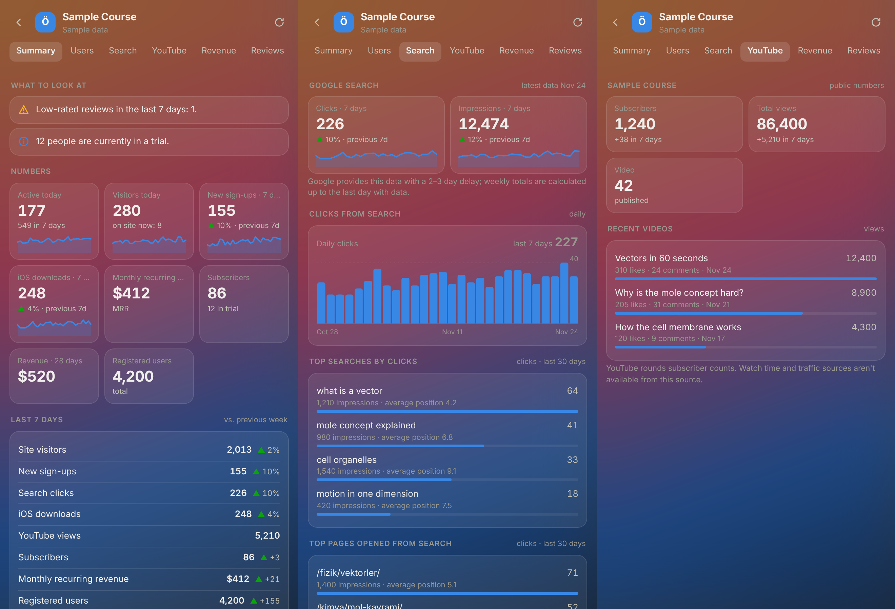
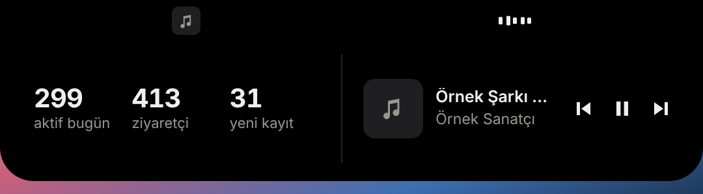

# Appati

Bütün uygulamalarının rakamları, Mac'inin kenarında tek panelde. Menü çubuğunda durur; simgeye tıklayınca (ya da ⌥⌘A) ekranın sağ kenarında açılır.



*Görseldeki sayılar örnek veridir. Solda koyu, ortada açık tema; sağda ayarlar.*



## Ne gösterir

| Kaynak | Ne gelir | Gereken |
|---|---|---|
| Supabase | Kayıtlı kullanıcı, günlük yeni kayıt, aktif kullanıcı, kendi tablo sayaçların | Proje adresi + gizli anahtar |
| Umami | Site ziyaretçisi, nereden geldikleri, en çok açılan sayfalar, ülkeler, şu an sitede kaç kişi var | Ücretsiz paylaşım bağlantısı (Share URL) |
| Google Search Console | Google aramasında tıklama ve gösterim, en çok getiren aramalar ve sayfalar | Mülk adresi + servis hesabı JSON'u |
| Google Analytics (GA4) | Site ziyaretçisi, nereden geldikleri, en çok açılan sayfalar, ülkeler | Property ID + servis hesabı JSON'u |
| RevenueCat | Abone, deneme, MRR, 28 günlük gelir | Project ID + gizli v2 anahtarı |
| App Store Connect | iOS yorumları, günlük ilk indirme | Apple ID, Issuer ID, Key ID, .p8 (+ indirme için Vendor Number) |
| Google Play | Android yorumları (son bir hafta) | Paket adı + servis hesabı JSON'u |

Her uygulama için yalnızca elinde olan kaynakları doldurursun; bir kaynak bozulursa diğerleri çalışmaya devam eder ve panel neyin okunamadığını yazar. "Bugün neye bakmalı" bölümü haftalık düşüşleri, düşük puanlı yorumları ve okunamayan kaynakları öne çıkarır.

Hiç uygulama eklenmemişken panel **örnek veri** gösterir ve bunu açıkça yazar.

## Kurulum

### Hazır uygulama
GitHub'da **Actions > Mac uygulaması** çalışmasının altındaki `Appati-mac` dosyasını indir, içindeki `.dmg`'yi aç, Appati'yi Uygulamalar klasörüne sürükle.

Depoya imzalama sırları eklenmediği sürece uygulama Apple Developer ID ile imzalı değildir (kurulumu: [docs/IMZALAMA.md](docs/IMZALAMA.md)). İlk açılışta macOS engellerse: **Sistem Ayarları > Gizlilik ve Güvenlik > Yine de Aç**, ya da Terminal'de:

```bash
xattr -dr com.apple.quarantine /Applications/Appati.app
```

### Güncelleme
İmzalı sürüm kendini günceller: açılıştan kısa süre sonra ve altı saatte bir GitHub'daki son yayına bakar, yeni sürümü arka planda indirir ve panelde "Yeniden başlat ve güncelle" gösterir. **Ayarlar > Güncelleme** altından kapatılır ya da elle denetlenir.

Yeni sürüm yayınlamak için: `package.json`'daki sürümü artır, `docs/SURUM-NOTU.md`'yi güncelle, **Actions > Mac uygulaması > Run workflow**'da "yayinla" kutusunu işaretle.

### Kaynaktan
```bash
npm install
npm start          # paneli çalıştır
npm run demo       # örnek veriyle çalıştır
npm run dist       # dist/ altına .dmg ve .zip üret (Mac'te)
```

## Çentik

Fare ekranın üst ortasına (MacBook çentiğine) gelince çentikten aşağı küçük bir özet açılır: bugünün rakamları ve çalan şarkı ya da video. Rakamlara tıklayınca tam panel sağda açılır; fare uzaklaşınca özet kapanır. Çentiksiz ekranda aynı yerde çalışır. **Ayarlar > Çentik** altından kapatılır.

Bir şey çalarken ada kapalıyken de çentiğin devamı gibi duran küçük bir şerit kalır (genişliği, yüksekliği ve saydamlığı **Ayarlar > Çentik** altından ayarlanır; yüksekliği kendi çentiğinle aynı olana kadar ayarla): solda albüm kapağı, sağda hareketli ses çubukları. Duraklatınca kaybolur. (Çubuklar süslemedir; gerçek ses düzeyini ölçmez.)

- **Spotify:** çalan şarkı, kapak, önceki / oynat-duraklat / sonraki. Spotify masaüstü uygulaması açık olmalı.
- **YouTube:** Chrome, Safari, Brave, Edge ya da Arc'ta açık videonun adı ve oynat/duraklat. Oynat/duraklat için tarayıcıda "Apple Events'ten JavaScript'e İzin Ver" açık olmalı (Chrome: Görünüm > Geliştirici; Safari: Geliştir menüsü).
- Anahtar gerekmez. macOS ilk kullanımda "Appati, Spotify'ı denetlemek istiyor" diye izin sorar. Çalan içerik yalnızca özet açıkken sorulur.

## Bildirimler ve menü çubuğu

- Yeni düşük puanlı yorum, yeni abone ya da okunamaz hâle gelen bir kaynak olduğunda Mac bildirimi gelir; tıklayınca ilgili uygulama açılır. İlk okumada bildirim gelmez, yalnızca sonradan değişenler haber olur. **Ayarlar > Genel** altından kapatılır.
- Simgenin yanındaki sayı seçilebilir: aktif kullanıcı, site ziyaretçisi, yeni kayıt, MRR ya da hiçbiri.

## Haftalık özet

Her uygulamanın Özet sekmesindeki "Son 7 gün" bölümü ziyaretçi, yeni kayıt, aramadan tıklama, indirme, abone ve geliri önceki haftayla karşılaştırır. Abone, gelir ve kayıtlı kullanıcının geçmişi hiçbir kaynakta durmadığı için Appati her gün gördüğü değeri saklar; bu satırların değişimi bir hafta sonra görünmeye başlar. Yeni haftanın ilk okumasında aynı özet bildirim olarak gelir.

## Site hunisi

Umami kutusundaki "Site hunisi" alanına adımları `Etiket | olay` biçiminde yazarsın. İlk adım son 30 günde siteye gelen tekil ziyaretçidir; sonraki adımlar o olayın kaç kez gerçekleştiğidir (kişi sayısı değil). ucler. şablonunda hazır gelir.

## Dönüşüm hunisi

Supabase kaynağındaki "Dönüşüm hunisi" alanına adımları sayaçlarla aynı biçimde yazarsın (`Etiket | tablo | filtre`). İlk adım her zaman kayıtlı kullanıcı sayısıdır. ucler. şablonunda hazır gelir: kayıt olan → hesabı eşitlenen → puan kazanan → bir aşama bitiren → Plus abonesi.

## Görünüm

- Panel macOS'un bulanık cam malzemesini kullanır; arka plan hafif saydamdır. Saydamlığı **Ayarlar > Görünüm** altındaki kaydırıcıyla ayarlarsın.
- Tema **Sistem / Açık / Koyu** seçilebilir. Sistem'de macOS görünümü değişince panel de değişir.
- Düğmeler ve odak çerçeveleri macOS vurgu rengini kullanır.
- Sistemde "Saydamlığı azalt" açıksa panel opak, "Kontrastı artır" açıksa çizgiler belirgin olur.

## Uygulama ekleme

Panelde dişli simgesi > **Uygulama ekle**. `ucler.` için hazır şablon vardır: proje adresi, paket adı, huni ve sayaçlar dolu gelir; yalnızca anahtarları yapıştırırsın.

Anahtarları nereden alırsın:

- **Supabase:** Project Settings > API keys > gizli anahtar (`service_role` ya da `sb_secret_…`). Appati yalnızca okur.
- **Umami:** Websites > siten > Edit > **Share URL**'yi aç, çıkan bağlantıyı yapıştır. Ücretli API anahtarı gerekmez. Bağlantıyı bilen herkes istatistikleri görebilir; kimseyle paylaşma.
- **Umami olay dökümleri:** Umami kutusundaki "Olay dökümleri" alanına `Etiket | olay | özellik` yazarsan o olayın son 30 günlük dökümü Özet sekmesinde görünür. ucler. şablonunda "En çok anlaşılmayan kartlar" hazır gelir.
- **Google Search Console:** Mülk olarak alan adını yaz (`ucler.app`). Servis hesabının e-postasını Search Console > Ayarlar > Kullanıcılar ve izinler'e ekle ve Cloud projesinde **Google Search Console API**'yi aç. Servis hesabı alanını boş bırakırsan Google Play'e girdiğin JSON kullanılır.
- **Google Analytics (Umami yerine ya da yanında):** Sitede GA4 kurulu olmalı. Analytics > Yönetici > Mülk ayrıntıları'ndaki sayısal Property ID'yi gir. Servis hesabının e-postasını Yönetici > Mülk erişim yönetimi'nde Görüntüleyici olarak ekle ve Cloud projesinde **Google Analytics Data API**'yi aç. Servis hesabı alanını boş bırakırsan Google Play'e girdiğin JSON kullanılır.
- **RevenueCat:** Project settings > API keys > New secret key (v2, *Charts metrics: read*). Project ID aynı sayfadadır.
- **App Store Connect:** Users and Access > Integrations > App Store Connect API. İndirme sayıları için anahtarın *Sales* yetkisi ve Vendor Number gerekir.
- **Google Play:** Google Cloud'da servis hesabı oluştur, JSON anahtarını indir, hesabı Play Console > Kullanıcılar ve izinler altında ekle.

### Supabase sayaçları
Her satır bir sayaç: `Etiket | tablo | filtre`. Filtre PostgREST biçimindedir; `{simdi}` ve `{bugun}` yer tutucuları kullanılabilir.

```
Plus abonesi | abonelik | ortam=eq.PRODUCTION&or=(bitis.is.null,bitis.gt.{simdi})
Günün sorusunu çözen (bugün) | gunun_sorusu | gun=eq.{bugun}
```

## Gizlilik

- Anahtarlar macOS Anahtar Zinciri'ne bağlı şifrelemeyle (`safeStorage`) yalnızca bu Mac'te saklanır; arayüze bir daha geri gönderilmez.
- Appati'nin sunucusu yoktur. Veriler doğrudan senin hesaplarından okunur.
- Yeni sürüm kurunca macOS, kayıtlı anahtarları okumak için Mac şifreni sorabilir (uygulama Developer ID ile imzalı olmadığından her sürümde bir kez). "Her Zaman İzin Ver" de. Pencere cevaplanana kadar panel bekler; reddedersen anahtarlar silinmez, Yenile'ye basınca yeniden sorulur.
- Sessiz hatalar `~/Library/Application Support/Appati/hata.log` dosyasına yazılır (yol Ayarlar > Sorun giderme'de görünür).

## Bilinen sınırlar

- Günlük aktif kullanıcı geçmişi hiçbir kaynakta hazır durmaz; Appati her gün gördüğü değeri saklar, grafik zamanla dolar.
- App Store indirme raporları bir-iki gün gecikmeli gelir.
- Google Play kurulum sayıları API'de yoktur; yalnızca yorumlar okunur.
- Umami, belgelenmiş API yerine kendi paylaşım sayfasının kullandığı uçtan okunur; Umami bunu değiştirirse okuyucunun güncellenmesi gerekir.
- Google Search Console verisi 2-3 gün gecikmeli gelir.
- Google Analytics bugünün verisini birkaç saat gecikmeyle işler; "şu an sitede" sayısı gerçek zamanlıdır.
- İnternet yokken (uyku sonrası, Wi-Fi kopuk) panel son okunan rakamları göstermeye devam eder ve bunu yazar.
- Kaynak okuyucular sahte yanıtlarla sınanmıştır (`npm test`); Umami gerçek bir paylaşım bağlantısıyla denendi; Google Search Console, Google Analytics, RevenueCat ve App Store gerçek anahtarla henüz denenmedi.

## Geliştirme

```bash
npm test                         # kaynak okuyucular ve ayar deposu
npm run preview                  # arayüzün ekran görüntüleri (preview/), Playwright gerekir
xvfb-run -a npm run smoke      # Linux'ta gerçek Electron ile uçtan uca test (panel, anahtar kaydı, çentik)
```

| Yol | Ne |
|---|---|
| `src/main/sources/` | Her veri kaynağı için bir okuyucu |
| `src/main/collect.js` | Kaynakları birleştirir, "neye bakmalı" notlarını üretir |
| `src/main/katalog.js` | Kaynak alanları ve hazır şablonlar (yeni uygulama şablonu buraya eklenir) |
| `src/main/store.js` | Ayarlar, şifreli anahtarlar, önbellek |
| `src/main/main.js` | Menü çubuğu simgesi, pencere, yenileme |
| `src/main/centik.js`, `src/main/medya.js` | Çentik adası; Spotify ve YouTube |
| `src/renderer/` | Panel arayüzü |
